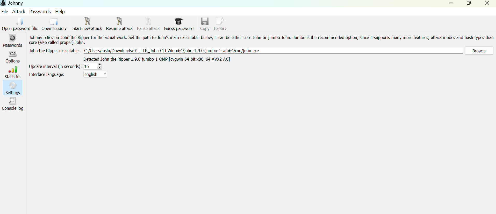
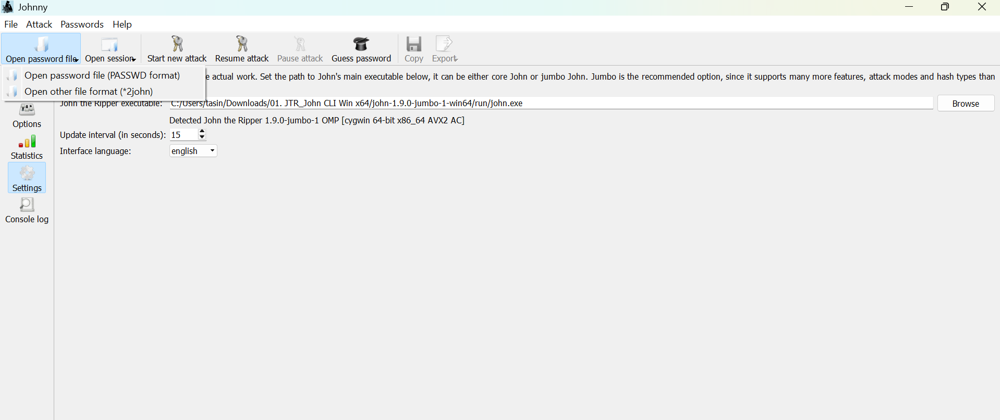
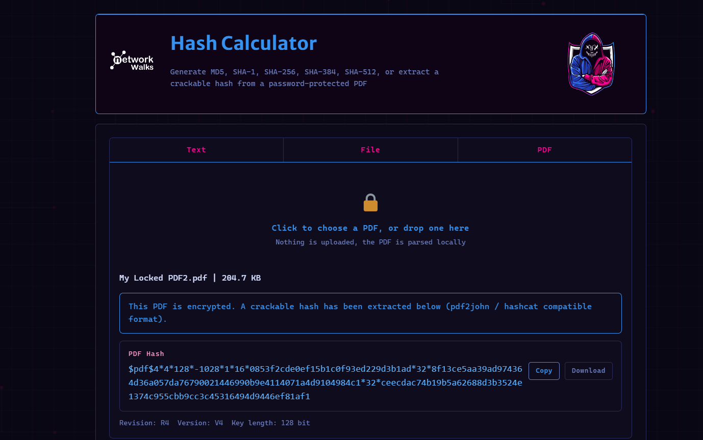
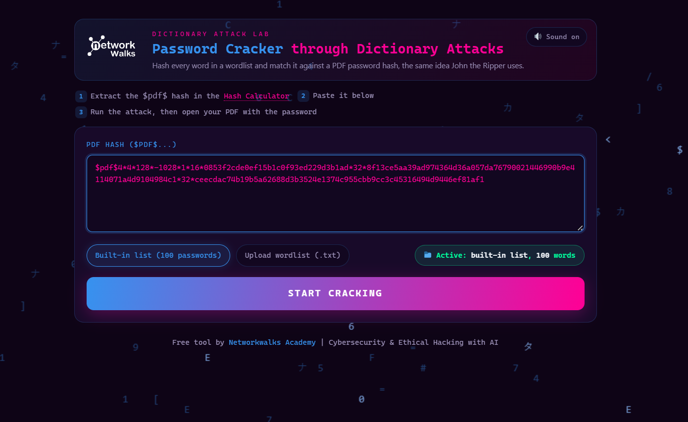
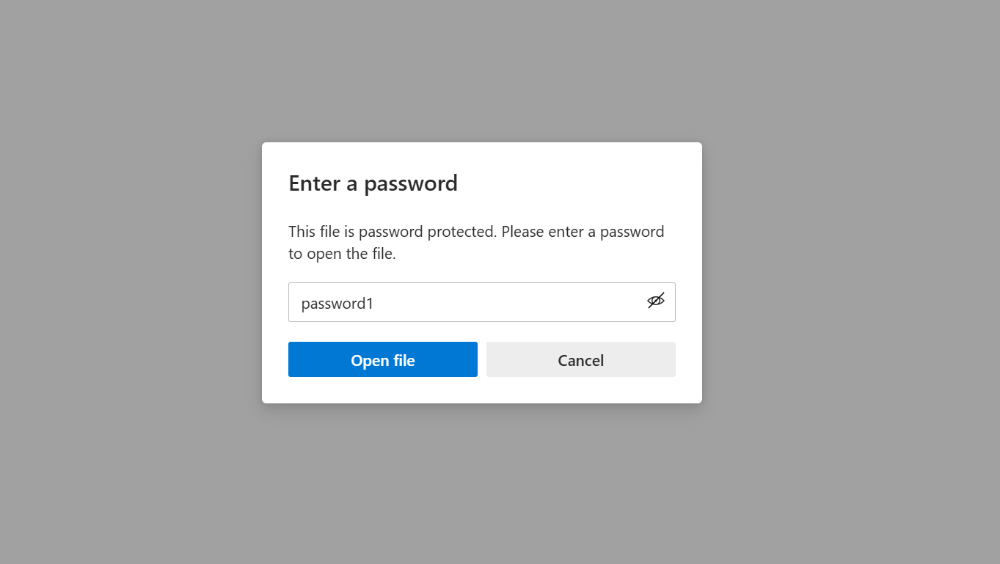

# Cracking-Password-JTR-Networkwalks-Tool-
learn how to crack password of a secure pdf.

## Lab setup :
Download John the Ripper from official website : https://www.openwall.com/john/     (zip,63MB )

Download Johnny GUI from Google drive : https://drive.google.com/drive/u/1/folders/1aHtgOh7U9mQhkN8VHU7ctTyaDg5KbuJx

After install Johnny , open Johnny. Click on settings & browse: (select John.exe)

   
&nbsp;

# Module 1 

## Step 1 : 
Open the hash website & upload pdf file to find its hash:
https://www.onlinehashcrack.com/tools-pdf-hash-extractor.php

Browse the PDF file and click on Upload. Select and copy the hash value. Save the hash value as text file.

## Step 2 : 
Open Johnny again . Click on 'Open password file' . Select the hash txt file .

Click on 'Start new attack'. Your PDF file password will be cracked.Now we can use this password to open PDF file.
Here is the PDF file :

&nbsp;

# Module 2 

## Step 1 :
Open the Networkwalks Hash Calculator in your web browser: https://networkwalks.com/hash-calculator/

## Step 2 :
Upload the locked PDF file to the Hash Calculator. The tool will read the file and give you the hash
value that starts with $pdf$...

Copy the full hash value.

## Step 3 :
Open the Networkwalks Password Cracker in your web browser: https://networkwalks.com/password-cracker/

Paste the hash value into the Password Cracker and start the attack. The tool will try different
passwords until it finds a match.

Wait for the tool to finish. The cracked password will be shown on the screen.

## Step 4 :
Open the locked PDF file and enter the cracked password. The PDF file will open.

